# Local Tax Migration

A working prototype of the BRD v3 design for moving local payroll taxes from QuickBooks Desktop Payroll to QuickBooks Online Payroll. Built for SPJIMR BDA (INF501), Group Exam Case 19.

**One business, start to finish.** The demo moves one business, **Buckeye Supply Co.** (152 employees, 313 Desktop local tax lines), from Desktop to Online payroll. A migration is always one business at a time; the same screens and tables would serve every customer.

**Model suggests, person decides.** The prototype finds the right local tax for every employee from their addresses, groups free-text Desktop labels with clustering, and routes every Desktop line to one of three places. Rules the employer approves settle most lines; people handle only the exceptions; nothing switches on until the employer confirms it.

## Open it

**Website: https://adarsh-panadath.github.io/local-tax-migration-prototype/**

Sign in with a demo account (no passwords). Progress is saved in your own browser only; **Reset the demo** (in the account menu, top right; two clicks) starts again.

**Product tour.** The front page is a short landing page for a business, with a **Watch the product tour** tile (0:57): a short film for businesses deciding whether to move. It shows the problem, what the product does for them, four real screens (see the result first, a few quick answers, Ask AI, go live) and the results. It plays in a window over the page; Esc or the close button stops it. The film is `web/media/tour.mp4` (1080p), narrated by a male voice, with on-screen captions and a quiet music bed. The voice is Kokoro (`am_michael`), an open-source text-to-speech model (Apache 2.0) run offline, reading the script in `docs/tour-script.md`.

To run it on your computer (Node.js 20 or later; no install step, no API keys):

```sh
npm start       # builds the app into dist/ and serves it at http://localhost:3000
npm test        # checks: engine, every scenario, the database and its keys, scale and the ML Lab
npm run schema  # rewrites docs/schema.* from the schema the app runs
```

Works on Windows, macOS and Linux. Nothing to install apart from Node.js: no packages, no database server, no keys. To use another port: `PORT=8080 npm start` (Windows PowerShell: `$env:PORT=8080; npm start`).

## Three people, one screen set each

| Sign in as | Their job | Screens |
| --- | --- | --- |
| **Business owner** (customer) | Move their own business, give the information only they have, confirm what is theirs | **Move** (start, check, summary), **To do** (one list: what only they can answer, each inside its record, and lines to confirm), **Go live** (with reconcile and W-2) |
| **Payroll tax expert** (Intuit) | Decide the lines the rules leave, one label at a time | **Queue** |
| **Admin** (Intuit) | See how the engine read the file, keep the model safe and the data right | **Engine**, **Model** (gates and thresholds), **ML Lab**, **Data**, **Scenarios**, **Log** |

All three work on the same business. The business runs its own move with the rules it approved; nobody runs automation for it.

The sign-in is a demo: in a real product customers would use their Intuit account and staff the company sign-in, and the role would decide the screens. A public static site cannot keep a password secret, so it does not pretend to.

## The design in one picture

```
Desktop payroll file
  │
  ├─ 0. Check the file ............ stop on broken data; clean up and report smaller problems
  ├─ Law ID of a known tax ........ maps straight to that tax (Law ID 177 or 0 = employer-created: carry on below)
  ├─ 1. Find the state ............ from the item label, else the home address, else the work address
  ├─ 2. List expected taxes ....... home address → school district, work address → city
  ├─ 3. Cluster custom labels ..... per state; name each cluster after the closest defined entry
  ├─ 4. Route every line
  │      ├─ Local tax ............. matched to an exact jurisdiction, rate checked
  │      ├─ Not a tax ............. moves to deductions
  │      └─ Not in database ....... goes to an expert: map / not a tax / custom entry / stop
  └─ 5. Employer confirms ......... by approved rules, or by hand; only then does the tax go live
        │
        ├─ Past payroll relabelled for W-2s (boxes 18–20)
        ├─ Gaps flagged both ways (expected but not withheld; withheld but not owed)
        └─ Reconcile after the first payroll and the first quarter
```

## The database

The data lives in a **SQLite database inside the page** (sql.js, compiled to WebAssembly; no server, no account, no keys), with primary keys, foreign keys and CHECK rules switched on. It is rebuilt on every visit. The engine reads the business back from the database with SQL, and a test checks that this equals the file exactly.

**Seven tables, one database per migration** (full explanation and likely viva questions: [docs/schema.md](docs/schema.md); the SQL: [docs/schema.sql](docs/schema.sql)):

| Group | Tables | In plain words |
| --- | --- | --- |
| From the Desktop file | `company`, `employees`, `payroll_items`, `desktop_lines` | The business, its people, its payroll items, and which person has which item |
| From Intuit's lookup | `addresses`, `taxes` | Which school district and city each address is in; the exact taxes and rates |
| Our result | `results` | Where each Desktop line went, the Online tax, and who decided |

**Law ID** is each tax's unique identifier and the key of `taxes`. A Desktop item QuickBooks already knows carries its tax's Law ID and maps straight to it; an item the employer created carries 177 (or 0), which names no tax. The story in one line: a **Desktop line** with Law ID 177 → the employee's **address** gives the school district → that matches a **tax** and its Law ID (5305) → the engine writes the **result**. (Law ID numbers in the demo are illustrative.)



The admin's **Data** page shows the schema read from the database itself: click a table for its columns and keys. **The database checks the data itself** has five buttons that each try to break a rule (a work address that does not exist, a duplicate employee, month 13, a 150% rate, an item that was never set up); the database refuses each one. **Download the database** gives the whole thing as a `.sqlite` file. The page also runs read-only SQL queries (with examples) and accepts **your own Desktop file as CSV**: it replaces Buckeye until you go back, and goes through the same file checks, database keys and engine. A file with missing columns or an unknown work site is refused with the reason, and so is one the database refuses (the same item twice for one person); a home address the lookup has never seen goes to an expert. See [the data contract](docs/data-contract.md) for the columns.

Customer payroll data stays fictional on purpose: real payroll files hold social security numbers and wages. Real companies demo the same way: invented people, real tax rules.

## The demo data

**One business: Buckeye Supply Co.**, 152 employees at two sites (Lancaster and Columbus, Ohio), 12 Desktop payroll items, 313 Desktop local tax lines, moving to Online payroll in October. It is generated from a fixed seed, so every visit sees the same people. Names, people, wages and labels are synthetic; the towns, ZIP codes, school districts and rates are real. Like a real Desktop file it is messy: free-text labels ("Schl Dist W/H", "school_district_wh_ohio", "Other Tax"), two missing home addresses and one the lookup cannot place, two people whose Desktop withholds the city tax of the town they live in instead of the work site's, a city tax item with no agency account number, people who moved, wrong rates, school tax withheld where none is owed, and taxes owed that nobody withheld.

Two other sets of data exist only for testing, not as businesses in the app:

- **Six small test files** (`data/companies.json`), one BRD case each, behind the **Scenarios** page (see below).
- **59 more generated businesses** in `tests/scale.test.mjs`, to check the engine and the database at 9,000+ employees.

## Automatic migration

The employer approves seven rules once, on the Move page's check step:

| Rule | What it settles |
| --- | --- |
| Confirm matches the address supports | Lines on the employee's expected list |
| Use the official rate when Desktop's rate is wrong | Over- or under-withholding, months withheld after a move (flagged for a correction) |
| Move after-tax deductions | Union dues and other non-tax items |
| Add expected taxes nobody withheld | Gaps, from the first cloud payroll (back tax flagged) |
| Stop taxes the address says are not owed | Duplicates, and taxes not owed at an address found in the lookup |
| Accept expert decisions | An expert's answer takes effect without a second click |
| Go live and reconcile when everything is settled | Only when nothing is left for a person and every check passes |

Only the cases the BRD reserves for people are left: a weak or missing label signal, conflicting evidence, a missing or unplaceable address, a question only the employer can answer (where someone works), a label naming another state, a state in shadow mode, or a missing agency account number. After a person decides one, the rules run again and finish the rest.

For Buckeye Supply Co., the rules settle **311 of 318 items (98%)**: 313 Desktop lines plus 5 taxes the addresses say are owed but nobody withheld. Left for a person: for the employer, 3 home addresses, where 2 people work and 1 agency account number; for an expert, 2 "Other Tax" lines (a weak label). Once the employer gives those and the expert decides "Other Tax" once, the rules finish the rest, go live and reconcile: 319 of 319 (one answer, "works at the site", adds the site's city tax that nobody withheld).

When an unclear label sits on a Desktop item many employees share, the expert decides what it means once, and each employee's address picks the exact tax.

## What only the employer can answer

Some facts only the employer has, so those lines wait for the employer, not an expert. The owner's **To do** lists them under **Needs you**, and each record opens with its question and form, so the owner answers it right there; the move summary has a button next to each that opens it:

| Kind | Why it is asked | What the owner does |
| --- | --- | --- |
| **Home address** | No home address in Desktop, or one the lookup cannot place. A school-district tax follows the home. | Types it (or **Fill a demo address**) and saves. |
| **Work location** | Desktop withholds the city tax of the town the person lives in, not the work site's. A city tax follows where the work is done. | Answers **At the site** or **From home**. From home: the home town's tax is the one owed. At the site: the site's tax is added (nothing withheld it) and the home town's line becomes optional courtesy withholding. |
| **Agency account** | An agency QuickBooks will pay has no account number or deposit frequency. | Types them (or **Fill a demo number**) and saves. |

An address or a work location is written to the database, the engine checks that employee's lines again, and the rules settle what they can. An address the lookup has never seen is kept, and the line stays with an expert, who can still map any of these lines.

## Proving the clustering: the ML Lab

The admin's **ML Lab** answers "does the clustering work beyond 53 labels?" with a test anyone can rerun:

1. Make 1,200 Desktop-style labels with known answers (600 or 2,400 on request; any seed).
2. Hold back 20%. Fit clusters on the rest with the engine's own code; no answers are used to fit.
3. Score the held-back labels exactly as the engine scores a new business's labels, and grade them.
4. Compare with simple word matching, which uses the same clean-up.

It shows the silhouette for every k with the 0.5 gate, every label on a 2D map, the confusion matrix, every wrong answer, and the clusters with their purity. With seed 2026 the model is right on 98.4% of its suggestions and suggests for 78.8% of labels; word matching is right on 98.2% and suggests for 90.8%. The silhouette is 0.462, below the gate, so on a set this messy the state would stay in shadow mode. The screen states these numbers and does not claim a winner: across seeds neither method wins every time. What clustering adds is grouping hundreds of spellings into a few dozen families an expert names once, and a confidence that says when to defer.

## Ask AI

A round **Ask AI** button sits at the bottom right of every screen; each page ends with room for it, so it never hides a button. It opens **Payroll AI**, a chat window you can **drag anywhere** by its header (double-click the header to put it back), resize from its corner, and that becomes a bottom sheet on a phone. It is the only AI in the app.

**It speaks first.** When it opens, it gives a short briefing for who you are and what you are looking at, and posts a new one as you move:

| You are on | The briefing |
| --- | --- |
| Sign-in | What each role does, and where to start |
| Move (owner) | How many items the rules settle, and what is left for you and for an expert |
| To do (owner) | What needs you: addresses, work locations, account numbers, items to confirm |
| A record you open (owner or expert) | Its opinion: recommendation, confidence, why, and one thing to check |
| Expert queue | The open lines, grouped by label |
| Go live | Which checks pass and what is next |
| Admin screens | What the engine, model, data, scenarios or log show |

A gold dot on the button means there is a new briefing for this screen. Then ask anything; the suggested questions change with the screen and the record ("Why does it matter where they work?", "Is the rate right?", "What if they move?").

Who answers:

| Where you run it | The AI |
| --- | --- |
| Hosted app on claude.ai | **Claude**, on your own Claude account (allow it when claude.ai asks) |
| Website or a local copy | The model you connect: open the **sliders** icon in the chat, choose a provider (**Google Gemini**, OpenAI, Anthropic Claude API, Groq, OpenRouter, Ollama on your computer, or any OpenAI-compatible address), paste your API key and click **Connect and test**. It lists the models your key can use and picks a fast one. |
| No model connected | The built-in assistant, which answers common questions from the same facts |

With a model connected, a **Check this with …** chip asks it for its own opinion on the record or screen. The briefings are always built in, so they appear instantly and cost nothing. Everything comes from one facts brief built from the engine's results (`web/assistant.mjs`); the model is told to use only those facts, and nothing it says decides anything: the employer still confirms every line.

**The key is never in the code.** It is typed into the chat and kept in your browser only (local storage), and sent only to the provider you chose; **Disconnect** removes it. Nothing about keys is in this repository or the published site. claude.ai does not let hosted pages call other AI services, so keys are for the website and local copies; the hosted app uses Claude.

## Try the clustering yourself

The admin's **Model** page starts with **Try the clustering**. Make up an employee (where they live, where they work) and the Desktop item on their paycheck (the label as typed, its Law ID, its rate), then click **Run clustering**. The real engine shows every step:

1. **Clean the label**: `Sch Dist Wthld` becomes the words `school district wthld`.
2. **Compare with every cluster**: a closeness bar for each cluster; the nearest one wins (School-district income tax, 0.41). The label is then shown in amber inside that cluster's card.
3. **How sure is it?**: the silhouette, (b − a) ÷ the larger of the two, against the 0.25 floor (0.39: confident).
4. **The address picks the exact tax**: the home address is in school district 2307, so Law ID 177 becomes **Law ID 5307**, Pickerington Local School District.

The example buttons show the other outcomes: the same label for someone living in Bremen becomes 5304 (the label says *what kind* of tax, the address says *which one*); union dues are not a tax; a misspelt `Pickrngtn Schl W/H` is nearest the right cluster but scores 0.24, below the floor, so it goes to an expert; a system item (Law ID 4140) needs no clustering. **Add to Buckeye** makes the person a real employee (before go-live): the line appears in the owner's To do or the expert's queue, and **Remove** takes them out again.

## Demo script (about six minutes)

1. **Sign in as the business owner.** Open **Ask AI** (bottom right): it already says what this screen is about. **Move**: Get started; the check says 311 of 318 items settle by rule, 6 things need the employer (3 home addresses, where 2 people work, 1 agency account number) and 2 need an expert. Click **Move to Online payroll**.
2. Open **To do**. **Needs you** lists six things; each opens with its form, and the next one opens after you answer:
   - Gabriel Bell, Imani Price, Kenji Lewis: **Fill a demo address**, then **Save**: the engine checks the line again and the rules settle it. (Type an address the lookup does not know, and the line stays with an expert.)
   - Tom Sanchez: Desktop withholds Columbus city tax, where he lives, not Lancaster's, where the site is. Answer **At Lancaster main site**: the Lancaster city tax nobody withheld is added, and Columbus becomes optional.
   - Maya Bell, the same question: answer **From home in Columbus**: Columbus city tax is the one owed.
   - City of Columbus Income Tax Division: **Fill a demo number**, then **Save**.
   Click a record and Ask AI gives its opinion on it; ask "What if they work from home?".
3. **Sign in as the payroll tax expert.** Two "Other Tax" lines are open. Decide once that the label means a school-district tax: each employee's address picks the exact district, and the rules go live and reconcile: 319 of 319.
4. **Sign in as the owner again.** **Go live**: every check passes; all $256,283.19 withheld in Desktop this year has a destination; the reconcile shows 9 local taxes on Online paychecks and groups the 197 notes by kind (wrong past rates, tax withheld but not owed). The W-2 cards show the local boxes.
5. **Sign in as the admin**:
   - **Engine**: what each step found for Buckeye: 291 expected taxes, 272 custom lines clustered, 269 local tax, 34 not a tax, 10 to an expert, 5 owed but not withheld.
   - **Model**: **Try the clustering**: run the example labels. (To add a person to Buckeye, do it before step 3: once the business is live, adding is switched off. Asha Verma from the first example lives in Pickerington and works in Lancaster, so the rules settle her school tax and add the Lancaster city tax nobody withheld: 321 of 321 settled.) Below it, Ohio passes every gate on the demo pool (silhouette 0.528 with 11 clusters, precision 100%, 53 labels). Set the silhouette threshold to 0.53 and Ohio drops to shadow mode.
   - **ML Lab**: 1,200 labels, 240 held back, precision and coverage against word matching, and the gate that keeps this messier set in shadow mode.
   - **Data**: the schema (7 tables), the five rule checks, **Items by Law ID**, **Law ID before and after** and **The address picks the tax**, and **Download the database**.
   - **Scenarios**: 76 of 76 pass.

## Scenario coverage

The admin's **Scenarios** page lists 76 scenarios, grouped by BRD step, and runs a live check for each one on a small test file made for that case:

| Test file | What it covers |
| --- | --- |
| Fairfield Hardware Supply | One of each route, a move, a gap, an over-withheld rate |
| Hocking Valley Dental | Core plan (the employer pays and files); a missing account number blocks go-live |
| Keystone Freight | Two states; Pennsylvania is still in shadow mode |
| Hocking Hills Fabrication | Moves in the migration month, remote work, duplicates, joiners and leavers, conflicting labels |
| Lakeview Bakery | Moves in January, so there is no Desktop history to relabel |
| Ridgeview Print Shop | A messy file: blank item name, unknown address, missing and duplicate items, 0% rate, a move to another state |

The same checks run in `npm test`, together with exact boundaries: a gate value equal to its threshold passes (silhouette 0.50, precision 98%, sample 40, label confidence 0.25), and a rate of 1.4999% against 1.5% counts as under-withheld.

## The screens

- Light grey page, white rounded cards, pill buttons and one emerald green. Colour has one meaning each: green is settled or ready, amber is waiting for the employer, blue is with an expert, red is a gap or a tax that is not owed.
- Wording never implies a decision nobody made: "Ready to confirm" (rule checks passed, still waiting), "Proposed for Online payroll", then "Confirmed by rule" or "Confirmed by the employer". Model output is labelled a suggestion.
- Records show the Desktop item and its Online destination, the next step, anything that needs checking, a Desktop-versus-Online table and the evidence. Explanations sit in folds ("How the system decided", "Model suggestion", "Decision history").
- Keyboard: a skip link, focus moves to what opens, and back to the next record after each action. On a phone, lists open into the record with the action bar at the bottom.

## What is real and what is not

| Part | Status |
| --- | --- |
| Ohio school-district codes, names, rates and tax bases | Real, from the Ohio Department of Taxation 2026 list (a small subset) |
| Lancaster 2.3% and Columbus 2.5% city rates | Real, from the city websites |
| Clustering, silhouette, precision gates | Implemented and tested; the gates use a 53-label pool written for this demo |
| ML Lab | Real computation with the engine's code, on 1,200 synthetic labels written from real label patterns |
| Buckeye Supply Co. | Synthetic, from a fixed seed; real towns, ZIP codes, districts and rates |
| Address lookup | A hand-made table of fictional addresses mapped to real districts. In production this is Intuit's tax applicability service |
| Database | Real SQLite, in the browser; rebuilt on each visit |
| Sign-in | Demo accounts without passwords |
| The business, employees, wages, account numbers | Fictional |
| Copying employees, pay items and totals in the Move step | Simulated; the local tax checks are real |
| Which taxes QuickBooks pays and files | A demo assumption, not an Intuit statement |
| Product tour narration | A synthetic voice (Kokoro, open-source text-to-speech) reading our script; nobody recorded it |
| Connection to QuickBooks | None |

This prototype is not affiliated with Intuit and is not tax advice. Synthetic labels are not real customer labels: the ML Lab shows the method and how the gates react, not production accuracy, which needs real Desktop files labelled by experts.

## Files

| Path | What it does |
| --- | --- |
| `web/engine/text.mjs` | Label clean-up (abbreviations, place names) and TF-IDF vectors |
| `web/engine/cluster.mjs` | Average-linkage clustering, silhouette, naming clusters, scoring and explaining a new label |
| `web/engine/analysis.mjs` | File checks, expected taxes, rollout gates, routing, rate checks, gaps |
| `web/engine/workflow.mjs` | Decisions, automation rules, go-live checks, dollar tie-out, W-2, reconciliation |
| `web/db.mjs` | The database (one per migration): schema, loading, reading the business back with SQL, results, queries, CSV import, added addresses |
| `web/generate.mjs` | Buckeye Supply Co. (and, for the scale test, 59 more), and the ML Lab's labelled set, from a fixed seed |
| `web/mllab.mjs` | The ML Lab: hold-out split, fit, scoring, baseline, confusion matrix, 2D map |
| `web/vendor/` | sql.js 1.14.2 (SQLite in WebAssembly, MIT licence) |
| `web/scenarios.mjs` | The 76 scenarios and their live checks |
| `web/assistant.mjs` | What Ask AI knows about a record: the facts brief, the built-in opinion and answers, and the format a model is asked for |
| `web/chat.mjs` | Ask AI: the round button, the draggable chat window, its briefings and its settings |
| `web/llm.mjs` | Connecting a model with your own key (Gemini, OpenAI-compatible, Anthropic): streaming, model lists, errors |
| `web/report.mjs` | JSON report and CSV export |
| `web/media/` | The product tour film and its poster |
| `web/app.mjs`, `web/styles.css` | The app |
| `data/` | Catalog, address lookup, the six scenario test files, expert-labelled label pool |
| `tests/` | Engine and workflow, every scenario plus exact boundaries, the database, scale (generated data, added addresses, ML Lab), "Try the clustering", Ask AI's facts and answers, the model connection, and the employer's answers (addresses, work locations, account numbers) |
| `.github/workflows/pages.yml` | Tests, builds and republishes the website whenever `main` changes |
| `docs/` | Design decisions and the data contract |
