# The database schema

*Generated from the schema the app runs (`npm run schema`). The SQL is in [schema.sql](schema.sql).*

## What a schema is

The schema is the blueprint of the database: which tables exist, their columns, the **primary key** that identifies each row, the **foreign keys** that link tables, and the **rules** the data must follow.

Think of a workbook: each table is a sheet, the columns are its headings, the primary key is an ID column that never repeats, and a foreign key is a column that must match an ID on another sheet. The difference: a database refuses a row that breaks a rule.

## One database per migration

A migration moves one business from Desktop to Online payroll, so the database holds that one business: **11 tables in three groups**, and no table needs a company id. Moving another business means a new database with the same tables.

| Group | Who it comes from | Tables |
| --- | --- | --- |
| 1. Desktop file | The business | `company`, `worksites`, `employees`, `home_addresses`, `payroll_items`, `desktop_lines` |
| 2. Tax lookup | Intuit | `addresses`, `taxes` |
| 3. Migration results | Engine and people | `expected_taxes`, `line_results`, `decision_log` |

Data moves one way: the Desktop file is copied into group 1 and never edited; the engine reads it with group 2 and writes what it finds, and what people decide, to group 3.

## One Desktop line, followed through the keys

1. `desktop_lines` has one row per employee per payroll item: (`employee_id`, `item_id`).
2. `employee_id` leads to `employees`, and `home_addresses` gives where that person lives.
3. The address's `school_district` in `addresses` is the same code as a school-district tax in `taxes`. **The address decides the exact tax**; the Desktop label only says what kind of tax it is.
4. `expected_taxes` lists what the addresses say each person owes; `gap = 1` means nothing in Desktop withholds it.
5. `line_results` says where the line ended up: its route, the Online tax, and who settled it. `decision_log` records every step.

The Data page's example query **One line across the keys** runs this join.

## Design choices

- **One fact in one place.** A tax's rate is stored once, in `taxes`; everything else points to it.
- **Home addresses have their own table** because people move. A move is a second row with the month it starts.
- **The Desktop file is never edited.** Results and decisions go to their own tables, so what Desktop said stays next to what happened.
- **Keys the database enforces.** The same item twice for one person, or a line for an item that does not exist, is refused when the file is loaded.

## Rules the database enforces

Every table has a primary key; foreign keys and CHECK rules are on. The Data page has five buttons that each try to break a rule. The database refuses every one, and nothing changes:

| Try to | The database answers |
| --- | --- |
| Add an employee at a work site that does not exist | FOREIGN KEY constraint failed |
| Add the same employee twice | UNIQUE constraint failed: employees.employee_id |
| Set the move month to 13 | CHECK constraint failed: month_1_to_12 |
| Give a tax a rate of 150% | CHECK constraint failed: rate_0_to_100 |
| Record a Desktop line for an item the business never set up | FOREIGN KEY constraint failed |

## Every table

### 1. Desktop file (The business)

| Table | What it holds | Primary key | Links to |
| --- | --- | --- | --- |
| `company` | The business being moved: one row. | `company_id` | - |
| `worksites` | Where its people work. | `site_id` | `address_id` → `addresses` |
| `employees` | The people on the payroll. | `employee_id` | `site_id` → `worksites` |
| `home_addresses` | Where each employee lives; a move adds a row from the month it starts. | `employee_id, from_month` | `address_id` → `addresses` `employee_id` → `employees` |
| `payroll_items` | Payroll items as set up in Desktop, with the label exactly as typed. | `item_id` | `system_tax_id` → `taxes` |
| `desktop_lines` | One row per employee per payroll item: a Desktop local tax line. | `employee_id, item_id` | `item_id` → `payroll_items` `employee_id` → `employees` |

### 2. Tax lookup (Intuit)

| Table | What it holds | Primary key | Links to |
| --- | --- | --- | --- |
| `addresses` | The addresses this business uses, with the school district and city the lookup places them in. | `address_id` | - |
| `taxes` | The local taxes Online payroll knows: rate, basis and agency. | `tax_id` | - |

### 3. Migration results (Engine and people)

| Table | What it holds | Primary key | Links to |
| --- | --- | --- | --- |
| `expected_taxes` | What each employee's addresses say they owe. gap = 1: owed, but nothing withholds it. | `employee_id, tax_id` | `tax_id` → `taxes` `employee_id` → `employees` |
| `line_results` | Where each Desktop line stands: route, Online tax, and who settled it. | `employee_id, item_id` | `employee_id, item_id` → `desktop_lines` |
| `decision_log` | Who did what and when. | `log_id` | - |

## Where it runs

SQLite inside the web page (sql.js, compiled to WebAssembly): no server, no account, no key. It is rebuilt every time the page opens. The tax catalogue, the address lookup and the model's labelled examples are Intuit's reference data; only the parts this business uses go into the database. In production the tables would live in a server database such as PostgreSQL.

## How to show it

1. Sign in as the admin and open **Data**. Click any table for its columns and keys.
2. Open **Diagram of the tables**.
3. Click **Try all** under "The database checks the data itself".
4. Run **One line across the keys**.
5. Click **Download the database** and open it in DB Browser for SQLite (free).
